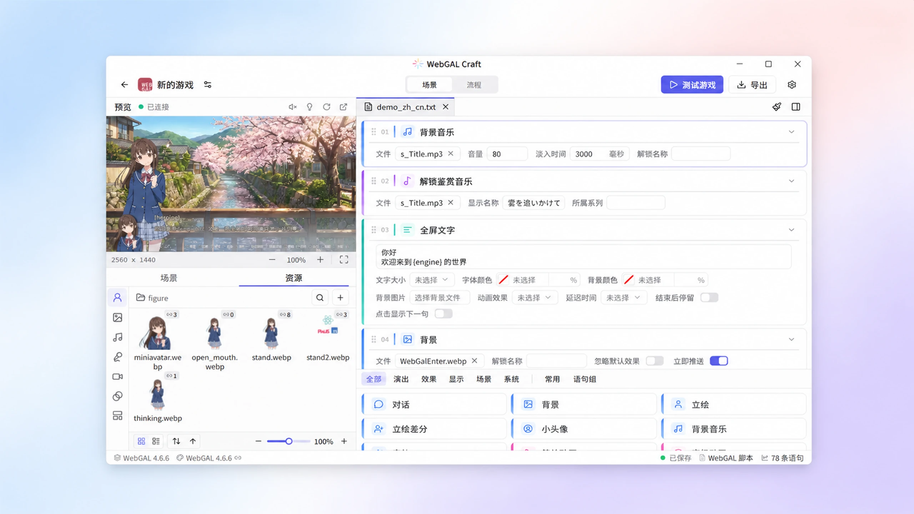

  <b>简体中文</b> | <a href="./README.zh-Hant.md">繁體中文</a> | <a href="./README.en.md">English</a> | <a href="./README.ja.md">日本語</a>

  <a href="https://github.com/A-kirami/webgal-craft">
     
    
     
    <h1 align="center">WebGAL Craft</h1>
  </a>

  <strong>面向 WebGAL 创作者的跨平台视觉小说工作室</strong>
   
  编写剧情、编排演出、管理资源、实时预览、一键导出，在一个窗口里完成。

  
  
  
  
   
  
  
  

  <a href="https://github.com/A-kirami/webgal-craft/releases/latest">下载最新版</a>
  ·
  <a href="https://webgalcraft.com">官方网站</a>
  ·
  <a href="https://github.com/A-kirami/webgal-craft/issues">反馈问题</a>
  ·
  <a href="https://qm.qq.com/q/W2Dt9V2F66">加入交流群</a>

  <picture>
    <source media="(prefers-color-scheme: dark)" srcset="./.github/assets/readme-hero-dark.webp" />
    
  </picture>

## 简介

WebGAL Craft 是一款面向 [WebGAL](https://github.com/OpenWebGAL/WebGAL) 游戏创作者的第三方视觉小说编辑器。它把游戏管理、脚本编辑、资源管理、演出调试和导出发布整合进同一个工作流：你可以用可视化表单组织剧情，也可以随时切回脚本精细调整；每一处修改都能在预览中立即看到效果。

- **所见即所得**：可视化编辑与脚本编辑双向同步，预览随编辑实时更新。
- **稳妥可靠**：自动记录场景历史版本，外部程序的修改可对比合并，删除的游戏与文件移到回收站。
- **跨平台**：支持 Windows、macOS、Linux 与 Android 平板，界面支持多种语言。

## 功能特性

### 可视化场景编辑

以卡片形式呈现每一条语句，通过表单编辑对话、立绘、背景、音频、分支等命令参数，无需记忆语法，也能随时切回脚本编辑同一份场景。

- 从命令面板拖放插入语句，拖动调整语句顺序
- 字段自动补全，常用命令可收藏、预设默认值或保存为语句组
- 统一诊断语法错误与缺失资源

### 剧情流程图

在画布上梳理主线与支线的场景走向，并用作游戏内的流程图展示。

- 从场景树把场景拖到画布上，生成节点并连线
- 主线之外可创建多条支线流程
- 在游戏配置中设置未解锁节点的展示方式

### 实时预览

编辑器内嵌 WebGAL 引擎预览，边写边看，不必在编辑器和游戏窗口之间来回切换。

- “执行到此句”：从任意语句直接跳转预览对应画面
- 在预览画面中直接拖动、缩放、旋转立绘与背景，参数自动写回语句
- 预览视图可自由缩放、平移，也能在浏览器中打开并保持同步

### 效果与动画编辑器

用图形化面板调整变换、滤镜等演出效果，并制作关键帧动画。

- 关键帧动画支持逐帧预览，并可在预览画面中拖动调整
- 动画可保存为动画文件，并在 `setAnimation` 语句中就地编辑引用的动画

### 资源管理

集中浏览立绘、背景、音频、视频等游戏资源，创作中随取随用。

- 悬停即可预览图片、音频与视频
- 显示资源引用次数，重命名或移动时自动更新引用
- 检测缺失与损坏的资源，并提供恢复流程
- 从系统文件管理器拖放导入场景与资源，或直接拖入编辑器使用

### 引擎与模板

按游戏需要管理 WebGAL 引擎与界面模板，适配不同版本和制作风格。

- 在应用内下载、更新 WebGAL 官方引擎，多个版本可以并存
- 拖放压缩包导入第三方引擎和模板
- 每个游戏独立绑定引擎与模板，随时切换或重置

### 游戏配置与导出

从配置到发布，不用离开编辑器。

- 通过表单编辑游戏配置，不用手动修改配置文件
- 用图标编辑器从一张图片生成 Web、桌面与移动端所需的游戏图标
- 导出为 Web 游戏，或同时导出 Windows、macOS、Linux 桌面游戏
- Android 安装包导出即将推出

## 下载安装

前往 [Releases](https://github.com/A-kirami/webgal-craft/releases) 下载适合你系统的最新版本。

| 平台 | 架构 | 安装包 |
| --- | --- | --- |
| Windows | x64 | `.exe` |
| macOS | Intel / Apple Silicon | `.dmg` |
| Linux | x64 | `.AppImage` / `.deb` |
| Android（平板） | arm64 | `.apk` |

首次启动时，新手引导会带你完成安装引擎、创建游戏和认识编辑器；快捷键可在“设置 → 帮助”中查看。

> [!IMPORTANT]
> WebGAL Craft 需要 WebGAL `4.6.2` 或以上版本的引擎。你可以在应用内直接下载官方引擎，也可以从 [WebGAL Releases](https://github.com/OpenWebGAL/WebGAL/releases) 获取后导入。

## 贡献

欢迎任何形式的贡献，包括报告问题、提出建议、改进文档和提交代码。开始之前，先阅读[贡献指南](./.github/CONTRIBUTING.md)。

## 许可证

- 代码：[MPL-2.0](./LICENSE)，© 2026 Akirami
- Logo：CC-BY-NC-ND，Designs by Akirami

## 鸣谢

感谢 [WebGAL](https://github.com/OpenWebGAL/WebGAL) 团队开发的视觉小说引擎。

### 贡献者

感谢以下贡献者对 WebGAL Craft 作出的贡献：

